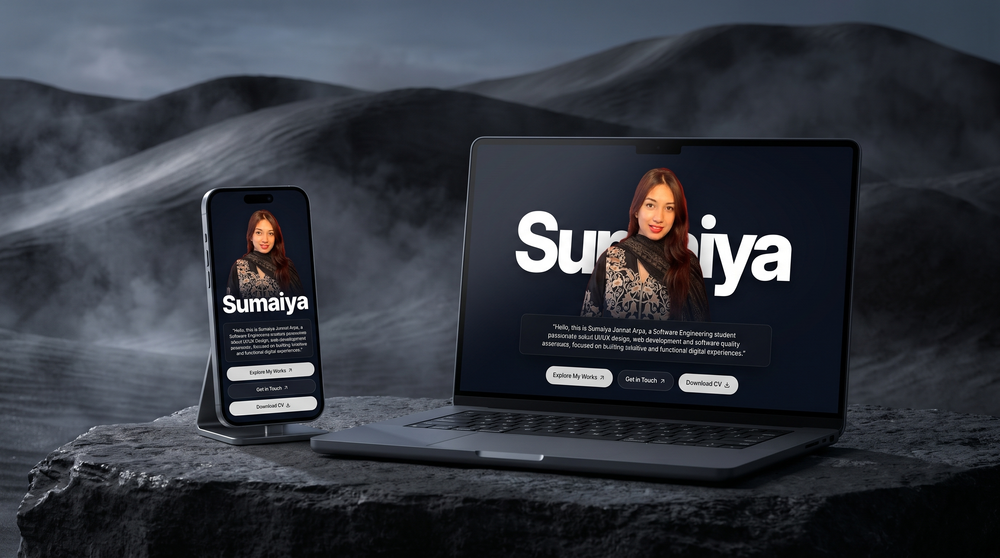

# Sumaiya Jannat Arpa — Personal Portfolio

[](https://sumaiya-jannat-arpa-portfolio.vercel.app)
[](https://github.com/jsumaiyarpa/sumaiya-jannat-arpa-portfolio)
[](https://react.dev/)
[](https://nodejs.org/)
[](https://expressjs.com/)
[](https://turso.tech/)

A modern, full-stack personal portfolio and content management system built for **Sumaiya Jannat Arpa**, Computer Science & Engineering undergraduate (Software Engineering major) at East West University, Bangladesh.

The website bridges **Software Engineering**, **User Experience Design**, and **Software Quality Assurance**, combining an interactive, editorial-grade frontend with a secure Node.js and Turso SQLite backend.

---

## Live Preview



*Explore the live deployment at [sumaiya-jannat-arpa.vercel.app](https://sumaiya-jannat-arpa.vercel.app).*

---

## About the Project

This portfolio showcases professional work, technical capabilities, leadership experience, and academic milestones in one cohesive digital hub. It serves both as a visitor-facing portfolio and as an administrative platform:

- **Professional Narrative:** Outlines background, academic coursework, honors, and technical credentials.
- **Multidisciplinary Showcase:** Categorized case studies across Software Engineering, UI/UX Design, SQA & Automation Testing, and Graphic Design.
- **Interactive Experience & Leadership:** Timeline-based view of industry experience, volunteer organizations, and community leadership roles.
- **Content Management:** An authenticated administrative suite for managing portfolio entries dynamically.

---

## Key Features

- **Responsive & Accessible UI:** Optimized across mobile, tablet, and ultra-wide displays with semantic markup, ARIA roles, and keyboard navigation.
- **Light & Dark Theme Engine:** Dual-palette styling system with persistent theme toggling and default system preference detection.
- **Project Case Studies:** Comprehensive project views with technical specifications, architecture overviews, challenge-solution breakdowns, live previews, and repository links.
- **Skills Matrix:** Categorized technical stack covering languages, frontend/backend frameworks, testing suites, UI/UX design tools, and DevOps utilities.
- **Experience & Leadership Timeline:** Interactive staircase cards highlighting professional roles, deliverables, and student organization leadership.
- **Direct Contact Form:** Asynchronous inquiry system powered by Web3Forms with client-side validation, loading states, and duplicate submission prevention.
- **Admin Dashboard & Authentication:** Role-based administrative dashboard protected by HttpOnly, SameSite=None, Secure cookies, SHA-256 session hashing, and rate-limited authentication.

---

## Technology Stack

### Frontend
- **Framework & Runtime:** React 18
- **Build Tool:** Vite 5
- **Routing:** React Router v6 (`react-router-dom`)
- **Styling:** Custom CSS Design System, Glassmorphic UI, CSS Variables
- **Icons:** Inlined SVG Icon Registry (Lucide specifications)
- **Form Delivery:** Web3Forms API

### Backend & API
- **Runtime:** Node.js (v18+)
- **Server Framework:** Express v5
- **Security:** Helmet (HTTP header hardening), CORS with credentials validation, Same-Origin checking
- **Rate Limiting:** `express-rate-limit` for brute-force protection
- **Authentication:** Bcrypt password hashing (`bcryptjs`), SHA-256 session token hashing, Secure HttpOnly cookies

### Database & Storage
- **Database:** Turso Database (Managed LibSQL / SQLite at the edge)
- **Client Driver:** `@libsql/client`
- **Schema Management:** Automated SQL schema, seed, and migration scripts

### Hosting & Infrastructure
- **Frontend Hosting:** Vercel
- **Backend Hosting:** Render
- **Database Hosting:** Turso Cloud

---

## Project Structure

```text
arpa-portfolio/
├── public/                     # Static assets (images, certificates, resume PDF)
│   ├── images/
│   │   ├── certificates/       # Course and competition certificates
│   │   ├── orgs/               # Organization and institutional logos
│   │   ├── projects/           # Project screenshots and design covers
│   │   └── reviews/            # Testimonial author avatars
│   └── resume/                 # Downloadable resume PDF
├── server/                     # Backend API server (Express + Turso)
│   ├── config/                 # Environment and server configuration
│   ├── db/                     # Turso database client initialization
│   ├── middleware/             # Authentication and security middleware
│   │   ├── auth/               # requireAdmin, requireSameOrigin
│   │   └── errorHandler.js     # Centralized error handling
│   ├── routes/                 # Express API routes
│   │   ├── auth/               # Login, session, and logout handlers
│   │   └── admin*.js           # CRUD controllers for portfolio data
│   ├── scripts/                # Database setup, admin seed, and verification scripts
│   ├── utils/                  # Cookie management, password and session helpers
│   └── server.js               # Express application entrypoint
├── src/                        # Frontend application (React + Vite)
│   ├── admin/                  # Admin dashboard, login, and CRUD views
│   ├── context/                # React Context providers (Projects, PortfolioData)
│   ├── data/                   # Fallback and static data definitions
│   ├── config/                 # API base configuration
│   ├── App.jsx                 # Application routes and route guards
│   ├── components.jsx          # Shared UI components, layout, and footer
│   ├── pages.jsx               # Main page views (Home, Work, Project, Gallery, Resume)
│   ├── main.jsx                # Application mounting entrypoint
│   └── styles.css              # Global styles, themes, and design system variables
├── turso/                      # SQL schema definitions, seed data, and rollbacks
├── .env.example                # Example environment variables template
├── index.html                  # HTML template entrypoint
├── package.json                # Project dependencies and npm scripts
└── vite.config.js              # Vite bundler configuration
```

---

## Getting Started

### Prerequisites

Ensure the following tools are installed on your local development machine:

- **Node.js** (v18.0.0 or higher recommended)
- **npm** (v9.0.0 or higher)
- **Git**

### Installation

1. **Clone the repository:**
   ```bash
   git clone https://github.com/jsumaiyarpa/sumaiya-jannat-arpa-portfolio.git
   cd sumaiya-jannat-arpa-portfolio
   ```

2. **Install dependencies:**
   ```bash
   npm install
   ```

3. **Configure environment variables:**
   Create a `.env` file in the project root based on `.env.example`:
   ```bash
   cp .env.example .env
   ```

   Populate the `.env` file with appropriate local development values:
   ```env
   # Server Configuration
   PORT=5000
   NODE_ENV=development

   # Frontend Client URL (for CORS and Origin validation)
   CLIENT_ORIGIN=http://localhost:5173

   # Turso Database Configuration (libsql:// or https://)
   TURSO_DATABASE_URL=libsql://your-database-name.turso.io
   TURSO_AUTH_TOKEN=your-turso-auth-token

   # Initial Admin User Credentials (used by server/scripts/createAdmin.js)
   ADMIN_USERNAME=admin
   ADMIN_EMAIL=admin@example.com
   ADMIN_FULL_NAME=Administrator
   ADMIN_PASSWORD=your-secure-password-12chars-min

   # Frontend Configuration (Vite)
   VITE_API_BASE_URL=http://localhost:5000
   VITE_WEB3FORMS_ACCESS_KEY=your-web3forms-access-key
   ```

4. **Initialize and verify the database (optional for local full-stack run):**
   ```bash
   # Run schema migration and initial content seed
   node server/scripts/runSchema.js
   node server/scripts/runSeed.js

   # Create initial admin account (using credentials from .env)
   node server/scripts/createAdmin.js

   # Verify database setup (optional)
   node server/scripts/verifySchema.js
   node server/scripts/verifySeed.js
   ```

### Running the Application

You can run the frontend and backend concurrently or independently:

- **Start the frontend development server:**
  ```bash
  npm run dev
  ```
  The client application will be accessible at `http://localhost:5173`.

- **Start the backend API server (with live restart):**
  ```bash
  npm run server:dev
  ```
  The API server will listen on `http://localhost:5000`.

- **Start the backend API server (standard production mode):**
  ```bash
  npm run server
  ```

### Building for Production

- **Generate production build artifacts:**
  ```bash
  npm run build
  ```
  Compiled output is saved to the `dist/` directory.

- **Preview the production build locally:**
  ```bash
  npm run preview
  ```

---

## Deployment

The project is architected for deployment across modern cloud platforms:

| Layer | Platform | Production Endpoint | Notes |
| :--- | :--- | :--- | :--- |
| **Frontend** | Vercel | [sumaiya-jannat-arpa.vercel.app](https://sumaiya-jannat-arpa.vercel.app) | Single-page application with client-side and section anchor routing. |
| **Backend** | Render | `https://sumaiya-jannat-arpa-portfolio.onrender.com` | Express web service with proxy trust, rate limiting, and CORS. |
| **Database** | Turso | Hosted LibSQL | Distributed SQLite database at the edge. |

### Deployment Best Practices
- **Frontend Environment Variables:** In the Vercel dashboard, configure `VITE_API_BASE_URL` and `VITE_WEB3FORMS_ACCESS_KEY`.
- **Backend Environment Variables:** In the Render dashboard, configure `NODE_ENV=production`, `CLIENT_ORIGIN=https://sumaiya-jannat-arpa.vercel.app`, `TURSO_DATABASE_URL`, and `TURSO_AUTH_TOKEN`.
- **Cross-Site Authentication:** The backend uses `SameSite=None; Secure; HttpOnly` cookies to permit authenticated administrative communication between the Vercel frontend and Render API domains.

---

## Author

**Sumaiya Jannat Arpa**

*Computer Science and Engineering Undergraduate (Software Engineering Major)*

East West University, Dhaka, Bangladesh

- **Portfolio:** [sumaiya-jannat-arpa.vercel.app](https://sumaiya-jannat-arpa.vercel.app)
- **GitHub:** [@jsumaiyarpa](https://github.com/jsumaiyarpa)
- **LinkedIn:** [linkedin.com/in/sumaiya-jannat-arpa](https://linkedin.com/in/sumaiya-jannat-arpa)
- **Email:** [jannat.sumaiyarpa@gmail.com](mailto:jannat.sumaiyarpa@gmail.com)

---

## License

This project is licensed for personal and academic portfolio presentation. Feel free to explore the architecture, patterns, and code structure as a reference.
